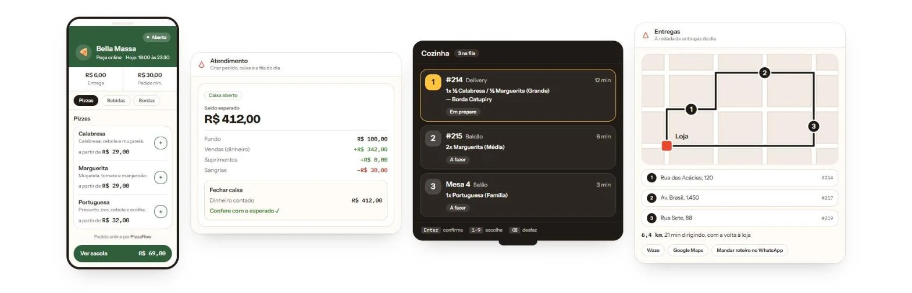
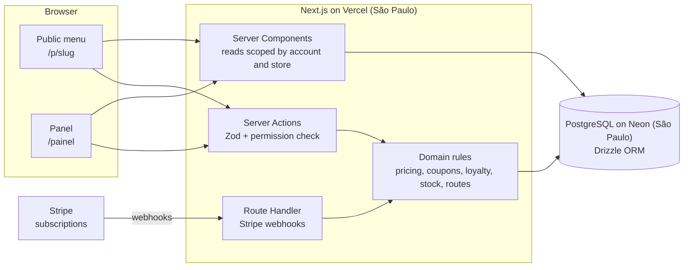

# PizzaFlow



<sub>Illustration of four product screens, from left: the customer's menu on a phone, closing the cash register, the kitchen queue in TV mode, and the delivery route.</sub>

PizzaFlow is the system I'm building for pizzerias. It runs in the browser, so nobody has to install anything. The customer orders from the store's menu link, without creating an account, and the team handles the counter, kitchen, tables and deliveries from one panel, on a computer, tablet or phone. Each store pays a monthly fee and I don't take a cut of the orders.

The site is here: [pizza-saas-delta.vercel.app](https://pizza-saas-delta.vercel.app). I built it and I keep it running, from start to finish.

The code is private because it's a product I sell, so this repo is the tour: what it does, how it's put together and some decisions I made along the way. If you want to see the real code, message me and I'll show you on a call.

So far it has 3,500+ automated tests, 50+ tables, 45+ migrations, 6 roles per store that can be combined, and 240+ commits since July 2026.

## What it does

**For the customer** (no login, no app)
- Delivery or pickup, right now or scheduled for later if the store allows it. The delivery fee can depend on the distance, in up to three bands
- Half-and-half pizzas, stuffed crusts, add-ons and combos, and the price updates as you choose
- Coupons, and a loyalty card (if the store wants one) that is just the customer's phone number. No code, no sign-up
- Pix by QR code or copy and paste. The money goes straight to the store's key, nobody in the middle
- A page to follow the order (received, preparing, ready, out for delivery, delivered), where the customer can also confirm it arrived
- At the table, scan the QR code and the order goes straight into that table's tab
- The menu shows the store's own name, color and logo, with one link per store

**For the team** (20+ screens, with roles per store)
- **Counter and cash register:** orders on four channels (counter, delivery, pickup and table), open and close the register, change fund, withdrawals, a payment split across two methods, and the expected balance checked against the counted cash at closing
- **Kitchen:** a three-column queue and a TV mode driven by the numeric keypad. `1-9` picks an order, `Enter` confirms, `Backspace` undoes. Optional stations (oven, bar, desserts) split the items by category, and scheduled orders wait aside until it's time to start. The kitchen can have the print dialog for each ticket open on its own when an order comes in
- **Tables:** dine-in tabs with an optional 10% service fee, transfer, merge tables, split per person, and a QR code per table
- **Deliveries:** the day's run in three lists, a map with the street path, the suggested stop order, distance and driving time, shortcuts to Waze and Google Maps, and the route sent to the driver over WhatsApp. Drivers don't need a login, and the panel shows how many deliveries each one made today and how much each one is owed
- **Menu, combos, coupons and stock:** four pizza sizes, items that are Active, Out of stock or Paused, half-and-half at the higher price or the average (each store chooses), coupons with a minimum order, an expiry date and an exact usage limit, and recipes per pizza size that can deduct ingredients when a sale closes
- **Reports:** revenue, sales, average ticket and items sold against the previous period, operation times (queue, prep, delivery, total) with mean and median, busiest hours and weekdays, products that didn't sell, and the full order history with filters kept in the URL
- **Customers:** a customer list that builds itself from paid orders, with New, Loyal and Lapsed segments, a profile per customer, and a ready-written WhatsApp message to win back the ones who stopped ordering
- **Printing:** four documents on 80 mm thermal paper: the kitchen ticket (no prices), the customer receipt, the table bill and the delivery label
- **Account:** several stores per account (billed per store), opening hours with an emergency pause, delivery bands and Pix key, branding, company details filled in from the CNPJ (Brazil's company tax ID), and team invites by link with stackable roles per store

I check every panel screen on a phone at 375 px (44 px touch targets, AA contrast). The kitchen screen was made for a tablet or a TV on the wall.

## How it's built



| Part | What I used |
| --- | --- |
| App | Next.js 16 (App Router), React 19, TypeScript strict, Tailwind CSS v4, shadcn/ui |
| Data | PostgreSQL + Drizzle ORM, money always in integer cents |
| Auth | better-auth, with organizations as tenants and roles per store |
| Billing | Stripe Checkout, Customer Portal and webhooks |
| Email | Resend |
| Maps | Leaflet, with the stop order computed on the server |
| Tests | Vitest (3,500+ tests). A feature is only done when typecheck, lint, build and tests pass |
| Hosting | Vercel and Neon, both in São Paulo. Local Postgres in Docker |

## Some decisions I made

**Each pizzeria only sees its own data.** Every query filters by account and store, and the Server Actions check the user's permission on the server too, the UI hiding a button isn't enough. There's a test suite that fails if one of those queries loses the account or store filter. On a separate note, I put a small open-source example of Postgres row-level security on GitHub, with tests that try to break it: [multi-tenant-rls](https://github.com/TowerTKL/multi-tenant-rls).

**The price is always calculated on the server.** The browser only sends what was ordered (ids and quantities), never the amount. The server works out everything again: sizes, half-and-half (higher price or average, as each store chooses), crusts, add-ons, combos, delivery fee, coupon and loyalty reward.

**A coupon can't be used more times than allowed.** The limit is checked by a single conditional `UPDATE`, in the same transaction that creates the order. If two customers try to use the last one at the same moment, only one gets it, and if the order fails the use goes back:

```sql
update coupons
   set used_count = used_count + 1
 where id = $1
   and active
   and (max_uses is null or used_count < max_uses)
returning id;
```

The loyalty reward works the same way, so two people at the counter can't spend the same reward twice.

**Closing the cash register happens on the server.** When the register closes, the server calculates the expected cash again with the register session row locked (`SELECT ... FOR UPDATE`). Anything that touches the drawer locks that session first. So if someone logs a withdrawal while the register is closing, it waits its turn instead of showing up as missing money, and these writes line up instead of deadlocking.

**Old orders don't change.** Each order item saves the name and price from the moment of the sale, so if the menu changes next month, last month's sales stay the same. What counts as a sale (paid and not cancelled) is defined in one function that all the revenue queries use.

**Days follow Brazilian time.** A sale at 11:30 pm on a Friday counts for Friday, no matter the server's time zone. Reports split the day at midnight in São Paulo, and the date filter still uses the index.

**I calculate the delivery order myself.** The server sorts the stops by nearest neighbour and then improves the route with 2-opt, which removes the crossings the first pass leaves behind. If the street routing service is down, the map draws straight lines and tells the user, and the deliveries can still go out.

**Billing runs on its own.** Stripe webhooks go to a Route Handler that saves each event id once, so if Stripe sends the same event again it isn't applied twice. The store's plan stays up to date without anyone touching it.

**The website can't promise what the product doesn't do yet.** A test reads the text of the sales site and fails if it finds a phrase from a blocklist, like live driver tracking, which isn't built yet.

**Careful deploys.** I review production migrations and run them by hand.

## Where it is now

PizzaFlow is online, in pre-launch. Billing still runs in Stripe's test mode, so no store is paying yet.

Next on the list:
- A no-login page per driver, with the route and delivery confirmation on the phone
- A self-serve free trial

## How I work on it

I design the data model and the architecture, and I use Claude every day to write, review and test faster. I write the decisions down in a `CONTEXTO.md` file and in two Obsidian vaults, one for the product and one for how the code connects, so I don't have to keep it all in my head.

---

Made by [Kevyn Tintino](https://www.linkedin.com/in/kevyntintino) · [GitHub](https://github.com/TowerTKL) · © 2026, all rights reserved
